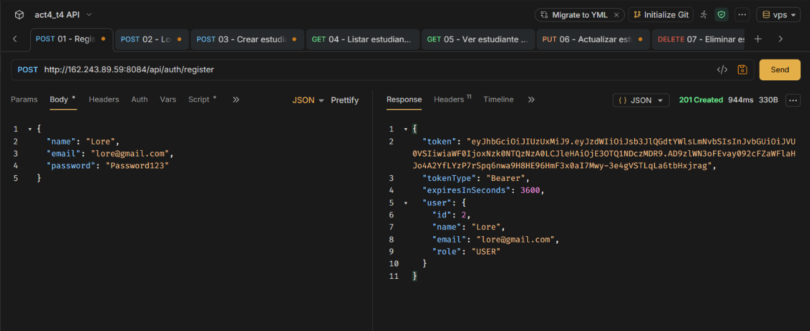
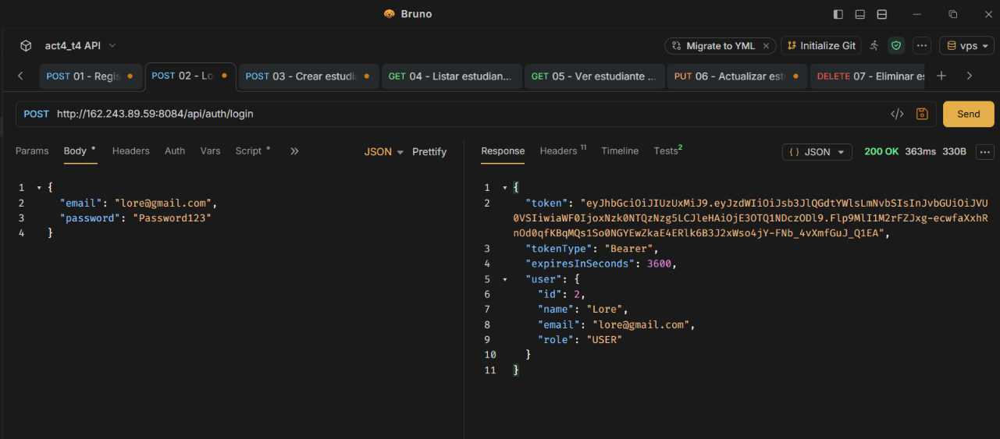
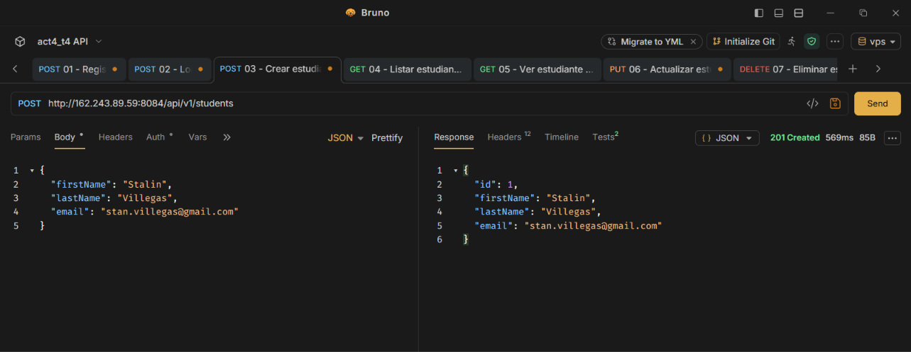
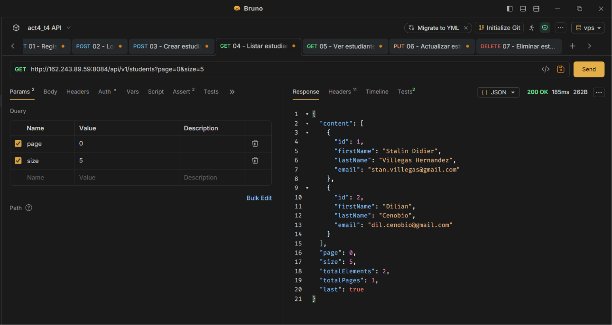
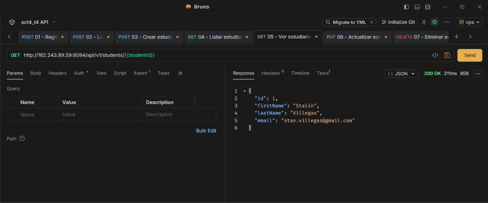
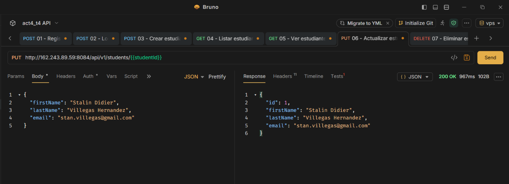
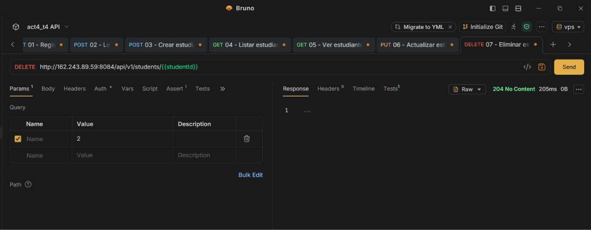
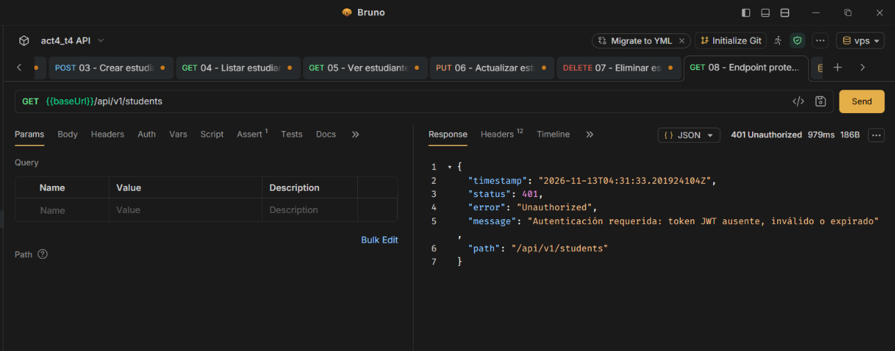
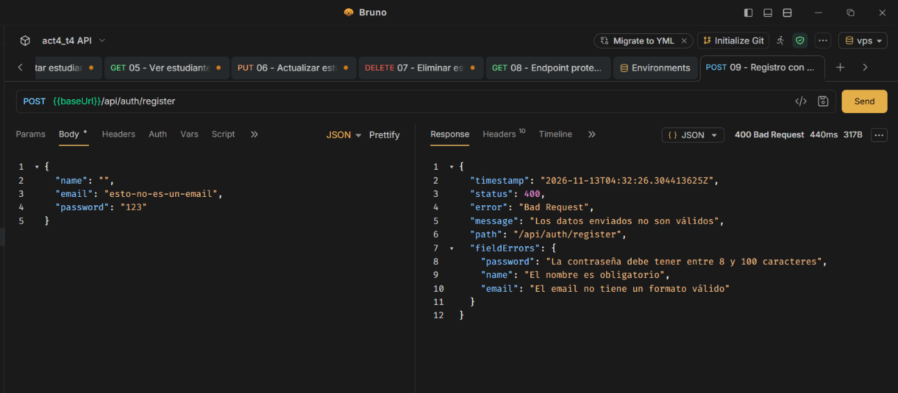
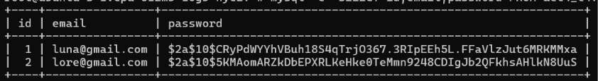

# Actividad 4. API REST con Spring Boot, Spring Security y JWT

* **Actividad:** `slcact4_t4`
* **Autor:** Sarai Luna Cenobio
* **Grupo:** 7SD
* **IP del VPS:** `162.243.89.59`
* **Puerto de ejecución (VPS):** `8084`
* **URL base:** http://162.243.89.59:8084


---

## Descripción

API REST pura en Spring Boot (sin vistas Thymeleaf) que responde siempre JSON. Implementa autenticación real con **Spring Security + JWT** y un CRUD completo de **estudiantes** conectado a MySQL. Incluye:

* Registro (`/api/auth/register`) y login (`/api/auth/login`) que devuelven un token JWT real, firmado con HS256.
* Contraseñas guardadas con hash **BCrypt**; nunca se devuelven en una respuesta.
* Un filtro de seguridad (`JwtAuthenticationFilter`) que protege todo el CRUD: solo pasa una petición con un token válido.
* **DTOs** para peticiones y respuestas (la Entity nunca se expone).
* Validación de entrada con `@Valid` y Bean Validation (`@NotBlank`, `@Email`, `@Size`), con errores claros por campo.
* Códigos de estado correctos con `ResponseEntity`: 200, 201, 204, 400, 401, 404, 409.
* Listado con **paginación**.
* Colección de **Bruno** versionada dentro del repositorio (carpeta `bruno/`).

---

## Estructura del proyecto

```
src/main/java/com/luna/slcact4_t4/
├── config/
│   └── SecurityConfig.java              (cadena de filtros, BCrypt, AuthenticationManager)
├── security/
│   ├── JwtService.java                  (genera y valida tokens)
│   ├── JwtAuthenticationFilter.java     (lee el header Authorization: Bearer)
│   ├── CustomUserDetailsService.java    (carga el usuario desde la BD)
│   ├── RestAuthenticationEntryPoint.java (401 en JSON)
│   └── RestAccessDeniedHandler.java      (403 en JSON)
├── controller/
│   ├── AuthController.java              (register / login)
│   └── StudentController.java           (CRUD protegido)
├── service/
│   ├── AuthService.java
│   └── StudentService.java
├── repository/
│   ├── AppUserRepository.java
│   └── StudentRepository.java
├── entity/
│   ├── AppUser.java
│   ├── Role.java
│   └── Student.java
├── dto/
│   ├── RegisterRequest.java, LoginRequest.java
│   ├── AuthResponse.java, UserResponse.java
│   ├── StudentRequest.java, StudentResponse.java
│   └── PageResponse.java, ApiError.java
└── exception/
    ├── GlobalExceptionHandler.java      (errores a JSON con el código correcto)
    ├── ResourceNotFoundException.java
    └── ConflictException.java

bruno/                                   (colección de Bruno y entornos local / vps)
deploy/                                  (init.sql, servicio systemd, plantilla de variables)
docs/img/                                (capturas del README)
```

---

## Base de datos

La base se llama `act4_t4`. Solo hay que crearla con `deploy/init.sql`; las tablas las crea JPA solo al arrancar (`spring.jpa.hibernate.ddl-auto=update`).


| Tabla | Descripción |
|-------|-------------|
| `tbl_user` | Usuarios de la API (`name`, `email` único, `password` en hash BCrypt, `role`) |
| `tbl_student` | Estudiantes (`first_name`, `last_name`, `email_address` único) |

---

## Endpoints

Todas las respuestas son JSON. Las rutas protegidas requieren el header:

```
Authorization: Bearer <token>
```

| Método | Ruta | Auth | Qué hace | Códigos |
|--------|------|------|----------|---------|
| POST | `/api/auth/register` | No | Registra un usuario y devuelve el JWT | 201, 400, 409 |
| POST | `/api/auth/login` | No | Inicia sesión y devuelve el JWT | 200, 400, 401 |
| GET | `/api/v1/students?page=0&size=10` | Sí | Lista paginada de estudiantes | 200, 401 |
| GET | `/api/v1/students/{id}` | Sí | Un estudiante | 200, 401, 404 |
| POST | `/api/v1/students` | Sí | Crea un estudiante | 201, 400, 401, 409 |
| PUT | `/api/v1/students/{id}` | Sí | Actualiza un estudiante | 200, 400, 401, 404, 409 |
| DELETE | `/api/v1/students/{id}` | Sí | Elimina un estudiante | 204, 401, 404 |

### Ejemplo: registro

Petición `POST /api/auth/register`:

```json
{
  "name": "Luna",
  "email": "luna@example.com",
  "password": "Password123"
}
```

Respuesta `201 Created` (el password no aparece):

```json
{
  "token": "eyJhbGciOiJIUzUxMiJ9...",
  "tokenType": "Bearer",
  "expiresInSeconds": 3600,
  "user": { "id": 1, "name": "Luna", "email": "luna@example.com", "role": "USER" }
}
```

### Ejemplo: crear estudiante

Petición `POST /api/v1/students`:

```json
{
  "firstName": "Ana",
  "lastName": "Lopez",
  "email": "ana.lopez@example.com"
}
```

### Ejemplo: error de validación (400)

```json
{
  "timestamp": "2026-11-13T02:55:31Z",
  "status": 400,
  "error": "Bad Request",
  "message": "Los datos enviados no son válidos",
  "path": "/api/auth/register",
  "fieldErrors": {
    "email": "El email no tiene un formato válido",
    "password": "La contraseña debe tener entre 8 y 100 caracteres"
  }
}
```

### Ejemplo: sin token (401)

```json
{
  "timestamp": "2026-11-13T02:55:31Z",
  "status": 401,
  "error": "Unauthorized",
  "message": "Autenticación requerida: token JWT ausente, inválido o expirado",
  "path": "/api/v1/students"
}
```

---

## Cómo funciona la seguridad

1. `register` guarda el usuario con el password en hash BCrypt y devuelve un JWT.
2. `login` valida las credenciales con el `AuthenticationManager` y devuelve un JWT con `sub` (email), `role`, `iat` y `exp`.
3. `JwtAuthenticationFilter` se ejecuta antes de `UsernamePasswordAuthenticationFilter`: lee `Authorization: Bearer`, valida firma y expiración y autentica la petición.
4. `SecurityConfig` deja públicas solo las rutas `/api/auth/**`; todo lo demás exige autenticación. Las sesiones son `STATELESS`.
5. Sin token, o con uno inválido o vencido, la API responde **401** en JSON sin ejecutar el controlador.

---

## Configuración (sin credenciales en el repositorio)

El archivo `application.properties` no contiene contraseñas ni secretos: todo se lee de variables de entorno. En local se guardan en un archivo `.env` (incluido en `.gitignore`) y en el VPS en un archivo `act4_t4.env` fuera del repositorio.

| Variable | Descripción | Obligatoria | Valor por defecto |
|----------|-------------|-------------|-------------------|
| `DB_PASSWORD` | Contraseña de MySQL | Sí | — |
| `JWT_SECRET` | Clave para firmar los tokens (mínimo 32 caracteres) | Sí | — |
| `DB_USER` | Usuario de MySQL | No | `root` |
| `DB_URL` | URL de la base de datos | No | `jdbc:mysql://localhost:3306/act4_t4` |
| `PORT` | Puerto de la aplicación | No | `8084` |
| `JWT_EXPIRATION_MS` | Vida del token en milisegundos | No | `3600000` (1 hora) |

---


## Colección de Bruno

La colección está en la carpeta `bruno/` y se versiona junto con el código.

1. En Bruno: **Open Collection** y se selecciona la carpeta `bruno/`.
2. Se elige el entorno `local` o `vps` (cada uno define `baseUrl`).
3. Las peticiones `01` y `02` guardan el token en una variable y las demás lo usan automáticamente.

| # | Petición | Resultado esperado |
|---|----------|--------------------|
| 01 | Registro | 201 |
| 02 | Login | 200 |
| 03 | Crear estudiante (POST) | 201 |
| 04 | Listar estudiantes paginado (GET) | 200 |
| 05 | Ver estudiante por id (GET) | 200 |
| 06 | Actualizar estudiante (PUT) | 200 |
| 07 | Eliminar estudiante (DELETE) | 204 |
| 08 | Endpoint protegido SIN token | 401 |
| 09 | Registro con datos inválidos | 400 |
| 10 | Login con password incorrecto | 401 |
| 11 | Estudiante inexistente | 404 |
| 12 | Token falso | 401 |


---

## Evidencias de funcionamiento

Capturas tomadas en Bruno apuntando al VPS (`http://162.243.89.59:8084`).

### 1. Registro
`POST /api/auth/register`: devuelve `201 Created` con el token y los datos del usuario, sin el password.



### 2. Login
`POST /api/auth/login`: devuelve `200 OK` con un token nuevo.



### 3. Crear (POST)
`POST /api/v1/students` con el token en `Authorization: Bearer`. Responde `201 Created`.



### 4. Leer (GET)
Listado paginado `GET /api/v1/students?page=0&size=5`:



Un estudiante por id `GET /api/v1/students/{id}`:



### 5. Actualizar (PUT)
`PUT /api/v1/students/{id}`: responde `200 OK` con los datos nuevos.



### 6. Eliminar (DELETE)
`DELETE /api/v1/students/{id}`: responde `204 No Content`.



### 7. Endpoint protegido sin token
`GET /api/v1/students` sin el header `Authorization`: la API lo rechaza con `401 Unauthorized`.



### 8. Validación de datos
`POST /api/auth/register` con datos inválidos: responde `400 Bad Request` con el detalle por campo.



### 9. Password guardado como hash
Tabla `tbl_user` en el VPS: el password se almacena con BCrypt, nunca en texto plano.




